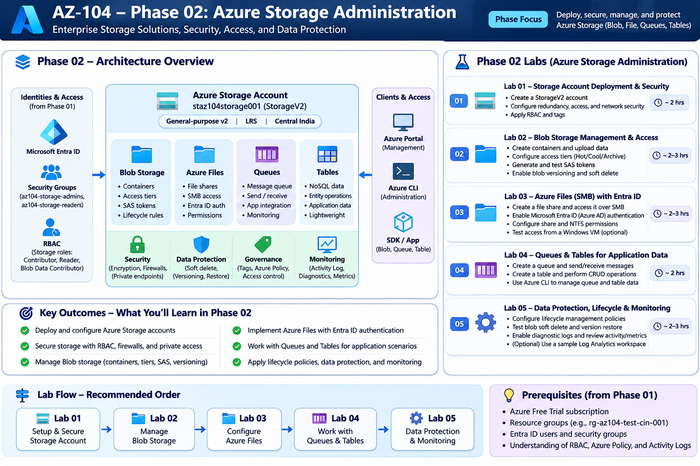

# AZ-104 — Phase 02: Azure Storage Administration

This phase builds and secures an Azure StorageV2 account, then applies its Blob, Files, Queue, and Table services to common administration scenarios. The five labs reuse the storage account created in Lab 01 and progress from account security to data protection and monitoring.

## Architecture

The design uses Microsoft Entra ID and Azure RBAC for authorized access, with network restrictions and storage data-protection features. A general-purpose v2 storage account provides Blob Storage, Azure Files, Queue Storage, and Table Storage.

## Learning outcomes

- Deploy a Standard StorageV2 account and choose an appropriate redundancy option.
- Apply secure transfer, TLS, anonymous-access, identity, RBAC, and network controls.
- Store and retrieve objects in private Blob containers; use tiers, SAS, versioning, and soft delete.
- Create an Azure file share, access it over SMB, and understand share permissions and recovery.
- Use Queue Storage for asynchronous messages and Table Storage for NoSQL entities.
- Protect data with recovery controls and lifecycle policies, transfer files with AzCopy, and review Azure Monitor metrics and alerts.
- Validate access and troubleshoot common authorization, firewall, and connectivity issues.

## Labs

| Lab | Focus | Main hands-on work |
| --- | --- | --- |
| [Lab 01 — Storage account security](lab-01-storage-account-security/README.md) | Establish the storage foundation | Create the resource group and StorageV2 account; apply tags, HTTPS/TLS, anonymous Blob access restrictions, storage RBAC, and selected-network rules; inspect service endpoints. |
| [Lab 02 — Blob Storage](lab-02-blob-storage/README.md) | Secure object storage and delegated access | Create private containers; upload, download, and validate sample files; test Blob data roles; explore access tiers and a short-lived user-delegation SAS; enable versioning and soft delete. |
| [Lab 03 — Azure Files](lab-03-azure-files/README.md) | Shared files over SMB and recovery | Create a file share and directories; test SMB connectivity and mounting where available; review share-level roles, snapshots, soft delete, and Azure File Sync concepts. |
| [Lab 04 — Queue and Table Storage](lab-04-queue-table-storage/README.md) | Asynchronous messaging and NoSQL data | Create a queue and table; send, receive, retry, and delete sample messages; perform entity CRUD operations; simulate an order worker and review metrics. |
| [Lab 05 — Data protection and monitoring](lab-05-data-protection-monitoring/README.md) | Recovery, cost management, and observability | Configure and test Blob/container recovery; create a scoped lifecycle rule; transfer sample data with AzCopy; explore metrics, alerts, diagnostic settings, and cleanup. |

Each lab has its own detailed instructions and evidence in its `screenshots/` folder:

- [Lab 01 screenshots](lab-01-storage-account-security/screenshots/)
- [Lab 02 screenshots](lab-02-blob-storage/screenshots/)
- [Lab 03 screenshots](lab-03-azure-files/screenshots/)
- [Lab 04 screenshots](lab-04-queue-table-storage/screenshots/)
- [Lab 05 screenshots](lab-05-data-protection-monitoring/screenshots/)

## Shared lab environment

- **Subscription:** Azure Free Trial (or another authorized subscription)
- **Resource group:** `rg-az104-storage-cin-001`
- **Region:** Central India
- **Account type:** Standard, StorageV2, LRS
- **Storage account name:** Use the globally unique name created in Lab 01. Replace placeholders in commands with that actual name.
- **Tools used:** Azure Portal, Azure CLI, Bash, PowerShell for Windows SMB tasks, and AzCopy in Lab 05.

The architecture diagram and lab examples use illustrative storage account names, including `appsharedfiles` in Lab 05; these may differ from the account deployed in Lab 01. Verify the actual account and substitute it in commands before running them. Azure account names are globally unique.

### Prerequisites and access notes

- An active subscription, sufficient remaining credit, and permission to create the listed resources.
- Familiarity with the Phase 01 Microsoft Entra ID and Azure RBAC exercises.
- A client network permitted by the storage firewall. Cloud Shell may use a different outbound IP than a local computer.
- For the Azure Files SMB exercise, TCP port 445 must be reachable; if it is blocked, use the documented portal or supported REST-based alternatives rather than bypassing network controls.
- Lab 04's worker exercise uses `jq`; Lab 05's transfer exercise uses AzCopy.
- Data-plane roles are distinct from management-plane roles. Being able to view or manage a storage account does not necessarily grant access to Blob, Files, Queue, or Table data.

## Important implementation notes

- Public network access and anonymous Blob access are separate controls. A reachable endpoint does not imply anonymous data access.
- Use Microsoft Entra authentication and the narrowest suitable data role where supported. Lab 01 keeps Shared Key access enabled temporarily for learning; evaluate disabling it only after confirming required clients support the alternative.
- The Azure Files SMB mount exercise uses a storage account key for its temporary lab connection. Assigning Azure Files RBAC roles alone does not configure identity-based SMB authentication or file-level ACLs.
- Queue Storage provides at-least-once delivery; application workers should be designed to handle retries and duplicate messages.
- Soft delete, versions, snapshots, lifecycle transitions, and monitoring can affect costs. Review retention, alert pricing, trial credit, and cleanup steps in the individual lab guides.
- The lifecycle rule and alert thresholds in Lab 05 are demonstrations, not production retention or monitoring recommendations. Review business and compliance requirements before using them on real data.

## Cost and security

The lab guides include cost targets as planning estimates, not guarantees. Actual charges vary by region, transactions, capacity, redundancy, retention, snapshots, networking, and monitoring. Check current Azure pricing and your subscription's remaining credit before creating resources
