# AZ-104 Phase 01: Enterprise Identity & Governance

This phase builds on the Azure foundation from Phase 00 and focuses on identity lifecycle management, least-privilege access, Azure Policy, remediation, and administrative auditing.

## Architecture

The diagram summarizes the identity and access flow, governance scope, monitoring, and the six-lab implementation sequence.

The labs use Microsoft Entra ID for users and groups, Azure RBAC for resource access, Azure Policy for compliance and remediation, and Azure Activity Log for administrative investigation. The architecture includes development and test resource groups and selective use of resource locks.

## Learning objectives

- Manage a test user's joiner, mover, and leaver lifecycle through Entra group membership.
- Create and assign a custom Azure RBAC role, then validate effective access.
- Troubleshoot authorization failures, inherited access, and overlapping role assignments.
- Build and assign an Azure Policy initiative and review compliance.
- Configure tag inheritance and remediate supported non-compliant resources.
- Investigate Azure control-plane operations using Activity Log.

## Lab guide

| Lab | Focus | Documentation |
| --- | --- | --- |
| 01 | Entra ID user lifecycle: joiner, mover, leaver | [Lab 01 README](lab-01-entra-user-lifecycle/README.md) |
| 02 | Custom Azure RBAC roles and least privilege | [Lab 02 README](lab-02-custom-azure-rbac/README.md) |
| 03 | Effective access and RBAC troubleshooting | [Lab 03 README](lab-03-rbac-troubleshooting/README.md) |
| 04 | Azure Policy initiatives and compliance | [Lab 04 README](lab-04-policy-initiatives/README.MD) |
| 05 | Policy remediation and tag inheritance | [Lab 05 README](lab-05-policy-remediation/README.MD) |
| 06 | Activity Logs and access investigation | [Lab 06 README](lab-06-activity-logs/README.md) |

## Screenshot gallery

The screenshots below are embedded from their existing lab folders and have not been modified.

> **Before publishing:** Some screenshots visibly include account, tenant, or subscription identifiers. Review them and confirm you want those details public before pushing this repository to GitHub.

### Lab 01: Entra ID user lifecycle

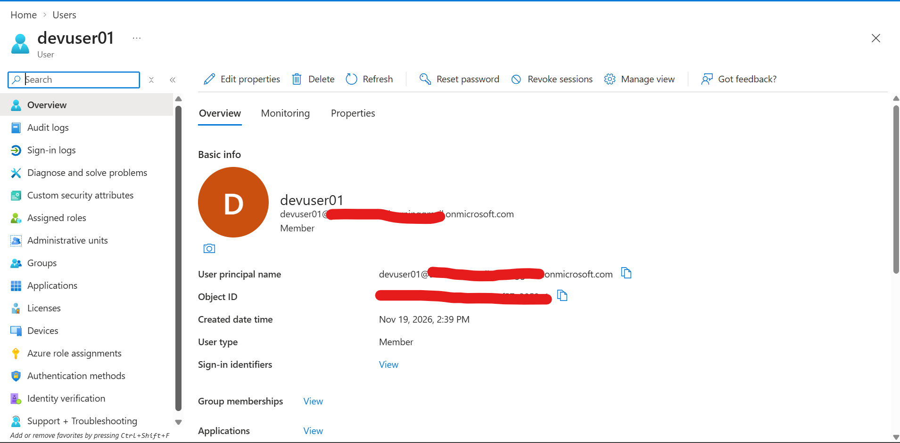

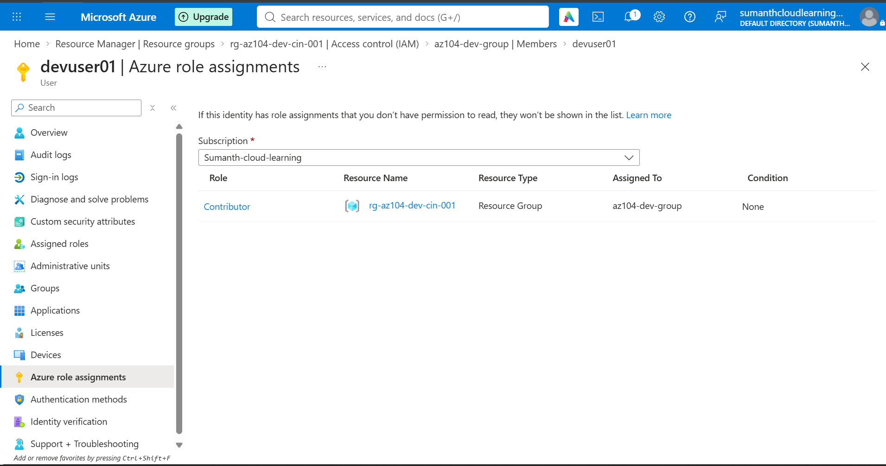

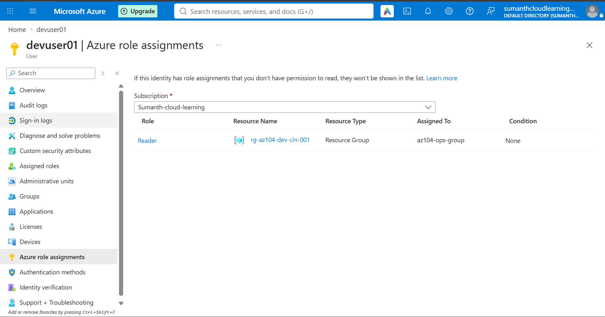

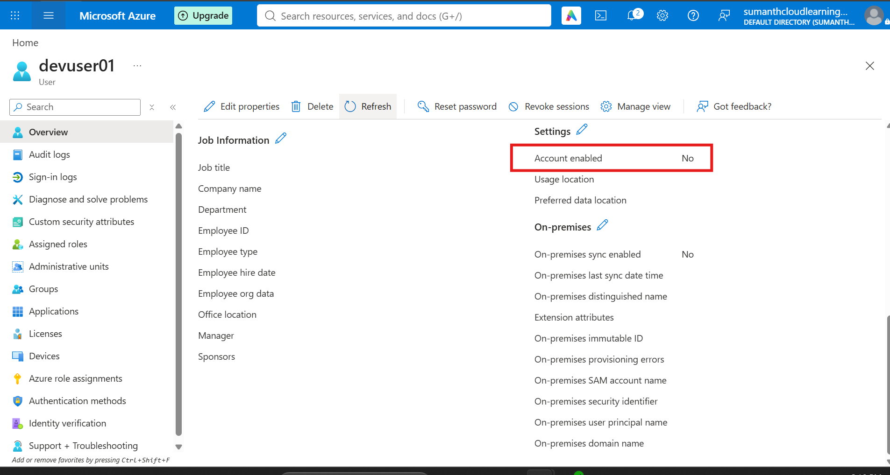

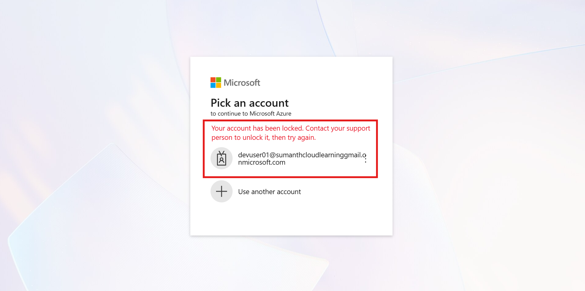

### Lab 02: Custom Azure RBAC

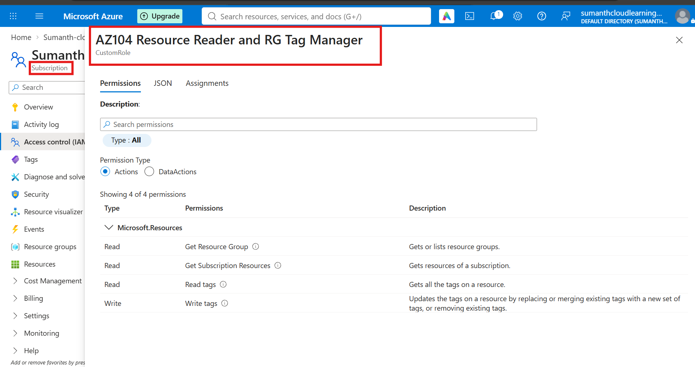

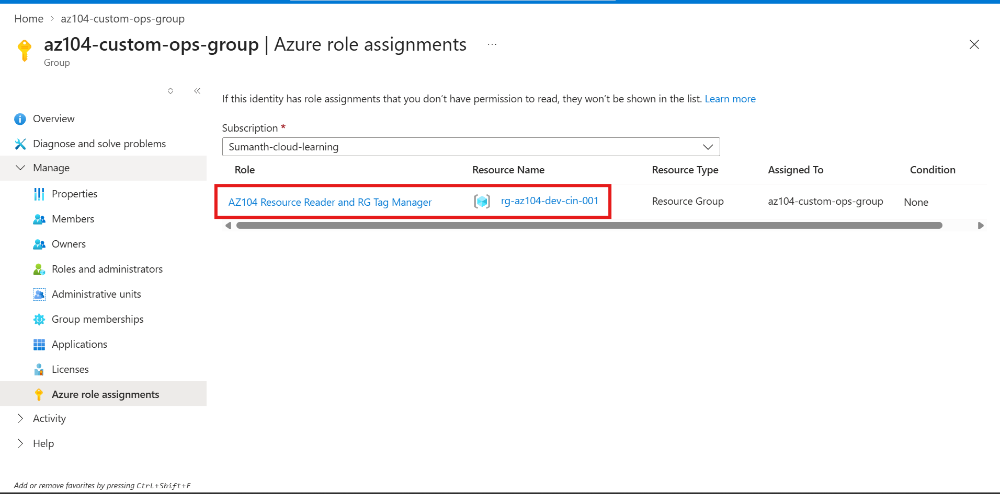

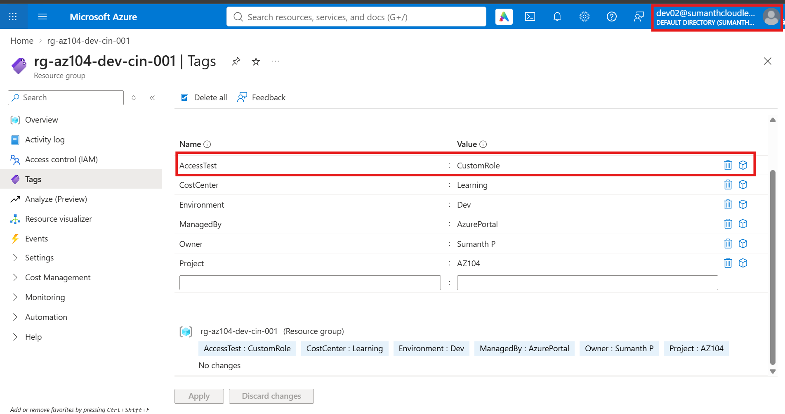

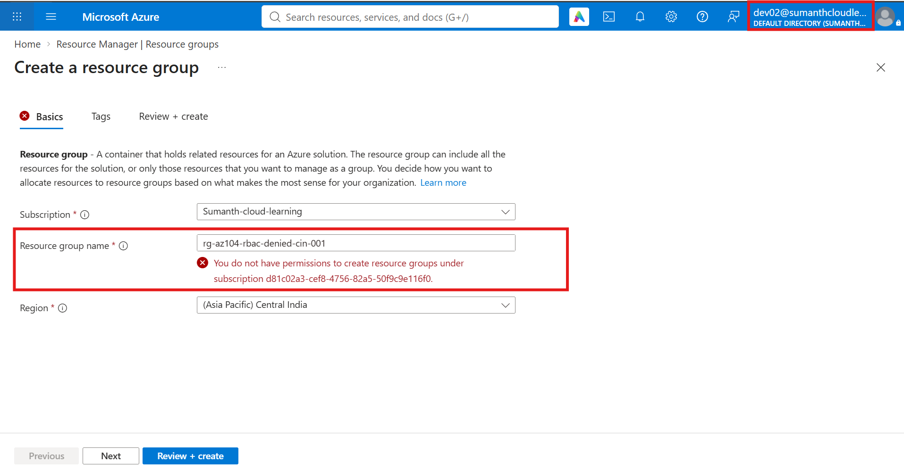

### Lab 03: RBAC troubleshooting

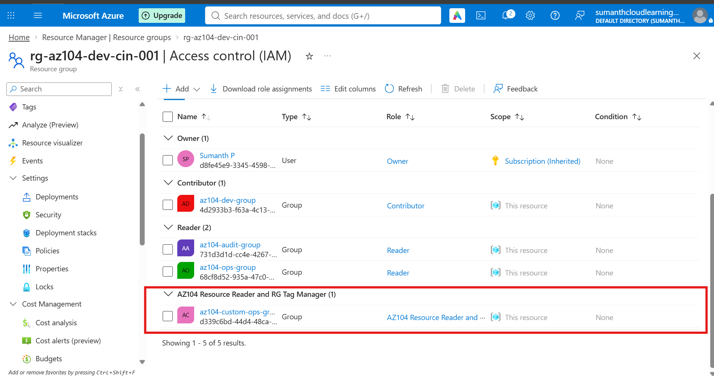

### Lab 04: Policy initiatives

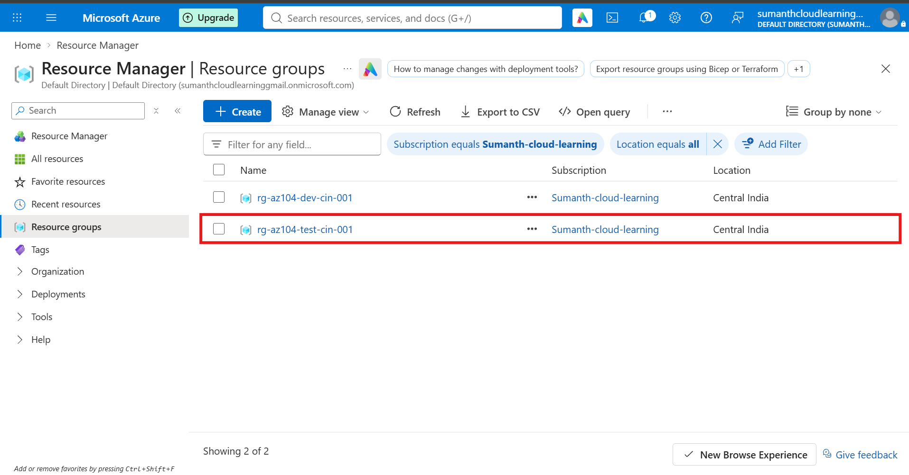

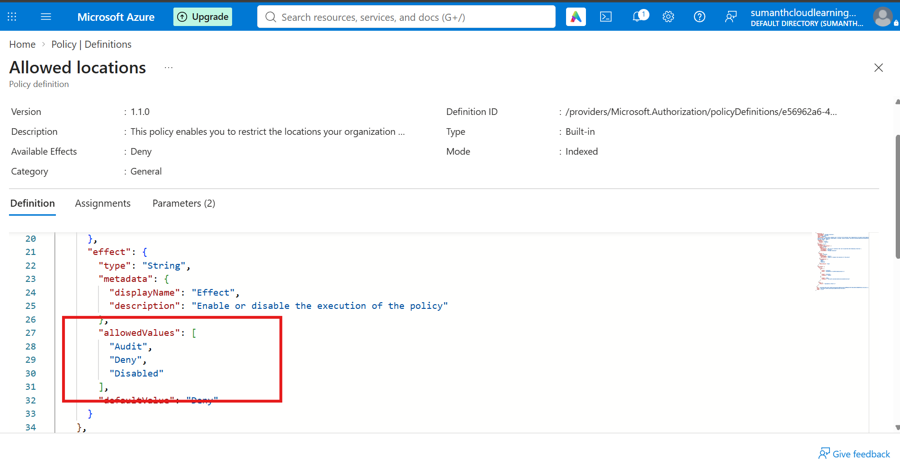

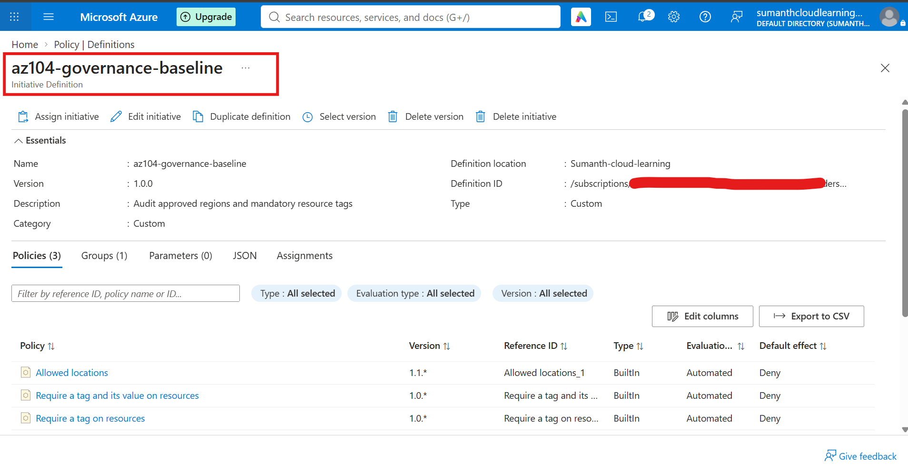

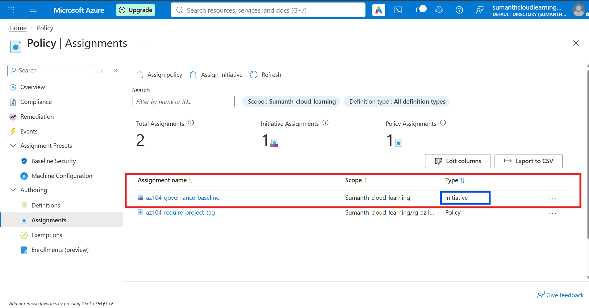

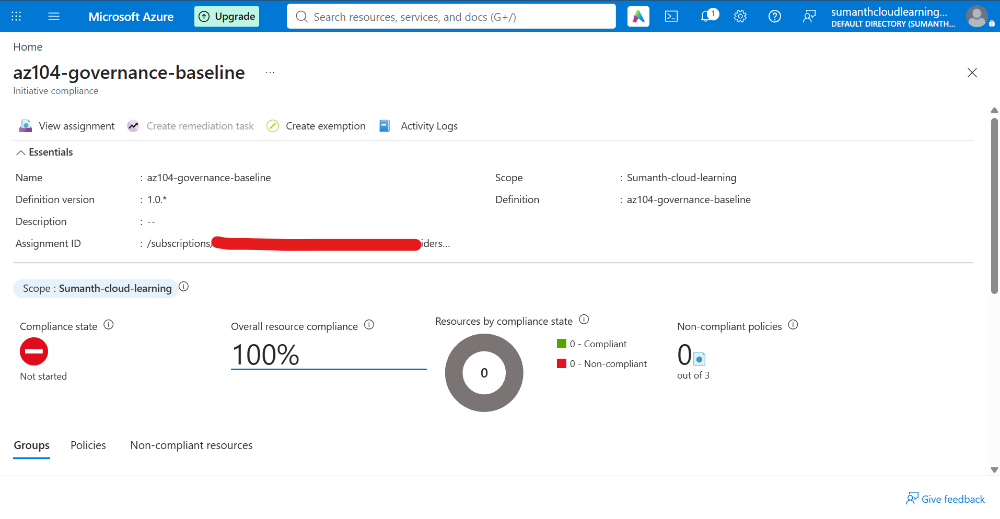

### Lab 05: Policy remediation

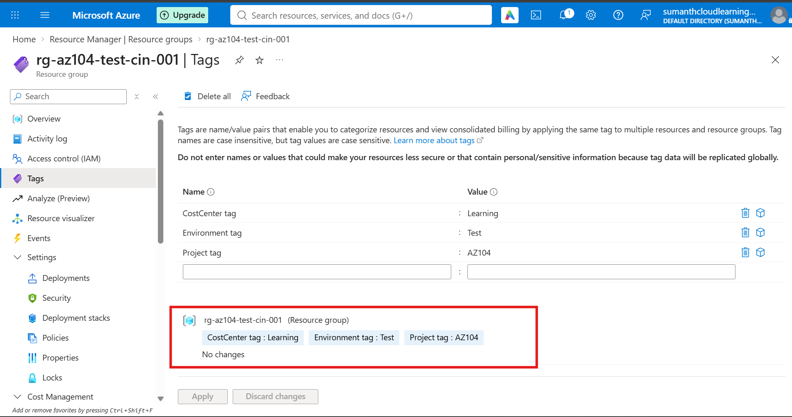

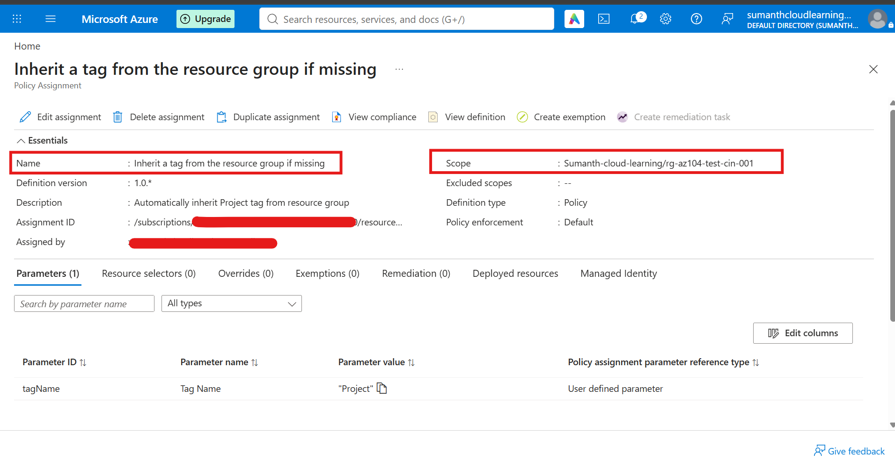

### Lab 06: Activity Logs

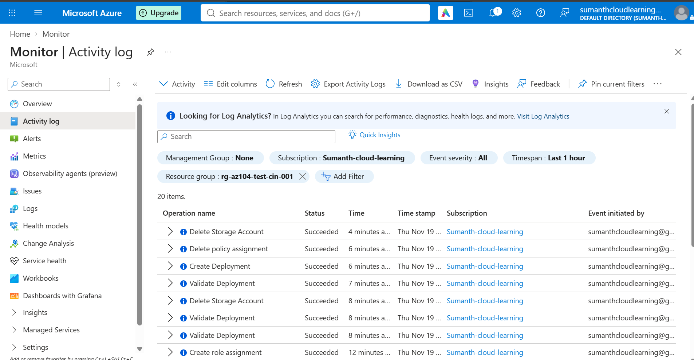